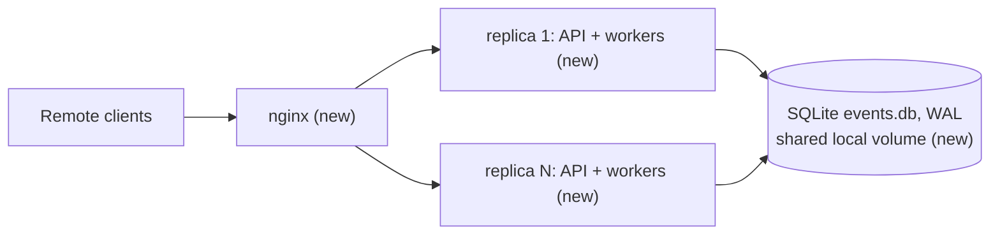

# Webhook Receiver Service

> Status: **draft for review**, 2026-10-19.
>
> - Open Questions Q1–Q12 were answered by the requester; see [Decisions](#-decisions).
> - A fresh-context architectural review ran: 0 Critical, 3 High, 7 Medium and 4 Low findings. All of them are folded into this revision.
> - Observability (structured logs, request ids, Prometheus metrics, failed-event listing) added on request, 2026-10-19.

## 📝 TLDR

Remote clients will send about 1,000 events per minute across many senders. They need somewhere to deliver webhook-style events and a reliable answer to "was this received, and was it handled exactly once?". Nothing exists today; the repository holds only a README.

The proposal is a dockerized Python (FastAPI) service that **will**:

- accept an event (`idempotency_key`, `event_type`, any JSON `payload`) and write it to SQLite before replying `202` with a unique receipt id;
- process it in the background exactly once, even across restarts and with several replicas running;
- answer duplicates with the original receipt;
- expose processing status and service health.

## 📝 Decisions

Answers to the Open Questions gate. Each one drives a section below.

| # | Question | Decision |
|---|---|---|
| Q1 | Duplicate POST response | `200` with the **original** receipt, its current status and `"duplicate": true`. A first-time POST gets `202`. |
| Q2 | Same key, different body | Reject: `409 Conflict`, problem type `idempotency-key-reused`. |
| Q3 | Key scope | **Per `event_type`**: uniqueness is on `(event_type, idempotency_key)`. |
| Q4 | Key retention | **Time window**: `IDEMPOTENCY_TTL`, default 24 h, **counted from when the event finished** (`completed_at`). After that the row is purged and the key can be used again. |
| Q5 | "Exactly once" | **Effectively-once**: the result is committed exactly once. A handler interrupted by a crash runs again, so handlers must be idempotent. |
| Q6 | Authentication | None in v1. A single `authenticate` FastAPI dependency (a no-op for now) is the extension point. |
| Q7 | Deployment | **Multiple replicas.** With SQLite this means replicas on **one host sharing one local volume** (see [Risks](#-risks--impact-review)). |
| Q8 | Status lookup | By receipt id only. |
| Q9 | Payload | Any JSON value (object, array, scalar, `null`). Request body max 256 KiB, `413` above that. |
| Q10 | Failure model | `failed` status with error text. 4 handler attempts in total (1 + 3 retries) with exponential backoff and jitter. |
| Q11 | Stack | Python 3.14, FastAPI, Uvicorn, Pydantic v2, `aiosqlite`, `pydantic-settings`. |
| Q12 | Spec location | `.ai/specs/` |
| — | Retry control | Added on request, 2026-10-19: a `PermanentError` raised by a handler skips the remaining retries and goes straight to `failed`; `POST /events/{receipt_id}/retry` replays a `failed` event. |
| — | Validation error code | **FastAPI's default `422 Unprocessable Content`** (changed from the original `400` on request, 2026-10-19). Only the body is reshaped to problem+json; the status code is not overridden. |

## 📝 Problem Statement

- **Retries create duplicates.** Senders retry after timeouts and network errors, so one event can arrive several times. Its effect must happen only once.
- **Senders need a fast acknowledgment.** Processing takes 2–5 s per event (stub). At ~17 events/s an average of 3.5 s means **~60 events in flight** at any moment. The HTTP reply cannot wait for that work.
- **Accepted means guaranteed.** Once the service has replied `202`, a crash, restart or redeploy must not lose the event or leave it unprocessed.
- **Clear errors.** Bad input returns FastAPI's default `422` with a readable body.

Target load: **sustained 1,000 events/min from many clients. The acceptance test is 2,000 events/min for 5 minutes, and it must still pass with one of two replicas killed.**

## 📝 Proposed Solution

**The database is the queue.** `POST /events` validates the request, then inserts it in one `BEGIN IMMEDIATE` transaction guarded by a `UNIQUE(event_type, idempotency_key)` index. Only after that commit does it return. No event lives only in memory.

- **Deduplication** comes from the unique index (insert, and on conflict read the existing row). It is never a check-then-insert sequence, so two replicas that receive the same key at the same moment cannot both create an event.
- **Processing** is done by an asyncio worker pool inside each replica:
  - A dispatcher claims due `queued` events with one atomic `UPDATE … RETURNING` statement. The statement sets a **lease**: owner, expiry, and a fresh random `lease_token`.
  - The handler (stub) runs. Its outcome is committed only if the row still carries that `lease_token`. This **fencing** is what makes the commit exactly-once.
  - A separate **reaper** statement returns expired leases (from crashed replicas) to `queued`. A starting replica must **not** reset all `processing` rows, because some belong to live replicas.
- **Retention:** a purger in each replica deletes events that finished more than `IDEMPOTENCY_TTL` ago. It works in batches and keeps going until there is no backlog left.

**Alternatives considered:**

| Alternative | Why it lost |
|---|---|
| In-memory `asyncio.Queue` / FastAPI `BackgroundTasks` | Loses accepted events on crash, which breaks the restart requirement. |
| Celery/RQ + Redis broker | Adds a second stateful system and still needs the DB for dedup. More moving parts than the load needs. |
| Huey with `SqliteStorage` | Queue state would be split from event state, so the atomic "result + status" commit is lost. |
| Separate worker container | Possible later (the worker is a module with its own entrypoint). Not needed now: one process per replica keeps deployment simple. |

## 📝 Research — what established tools do

- **Stripe idempotency keys:** keys are reusable after 24 h (hence our default TTL). A replay returns the stored result, and reusing a key with different parameters is an error. We copy all three behaviours (Q1, Q2, Q4).
- **Standard Webhooks (the open spec used by Svix and others):** a `webhook-id` header acts as the idempotency key, and an HMAC signature covers `id.timestamp.body`. We are not adopting this in v1 (Q6). The `authenticate` dependency is placed so a Standard-Webhooks verifier can be added without changing the API shape.
- **Hookdeck / Convoy (ingest gateways):** both deduplicate within a configurable window and keep delivery attempts visible. Our TTL window and our `attempts`/`last_error` fields cover the same need.
- **Postgres job queues (River, procrastinate, Oban):** lease claims, an attempt counter kept separate from crash recovery, backoff, and token-fenced completion. Our design follows them. SQLite has no `SKIP LOCKED`, so we rely on its single-writer lock with very short transactions instead.
- **What we deliberately skip:** fan-out to subscribers, payload transformation, a replay UI, per-source configuration.
- **Retry classification and replay** follow the same job queues: a "don't retry" error (Oban's `{:cancel, …}`, River's `JobCancel`) and a manual retry of a discarded job. Ours are `PermanentError` and `POST /events/{id}/retry`.
- **What we defer:** request signing (Q6), bulk replay (by filter), and distributed tracing (OpenTelemetry). The request id (see [Observability](#-observability)) is the seam for tracing.

## 📝 Architecture



Every replica is identical and stateless. The shared SQLite file is the only coordination point.

**Modules** (package `webhook_receiver`):

| Module | Responsibility |
|---|---|
| `config.py` | `Settings` via `pydantic-settings`. All tunables below are environment variables. |
| `api/` | Routers (`events` including the listing, `health`, `metrics`), request/response models, the `authenticate` dependency, a pure-ASGI body-size limit middleware, problem+json handlers for `RequestValidationError` (keeps the default `422`), `StarletteHTTPException` (404/405) and store errors. |
| `store/` | An `EventStore` protocol plus `SqliteEventStore`. **All** SQL lives here. The protocol is the seam for a later Postgres implementation (see Risks). |
| `worker/` | `Dispatcher` (reaper, claim loop, concurrency semaphore), `run_one` (handler call, then complete, retry or fail), `Purger` (retention, WAL checkpoint). |
| `processing/` | A `Handler` protocol `async (event, ctx: HandlerContext) -> JsonValue` (its docstring states the idempotency contract and the `PermanentError` convention), `errors.py` with `PermanentError`, `StubHandler`, and a registry keyed by `event_type` with a default. Each registration carries a `HandlerSpec(name, timeout, max_concurrency)`. `HandlerContext` exists from Phase 2 so that Phase 5 does not change the handler signature (see [Long-running handlers](#long-running-handlers-phase-5)). |
| `observability/` | `structlog` JSON logging setup, the request-id middleware (also writes the access log), the Prometheus metric definitions, and the queue collector. |
| `main.py` | The app factory. A lifespan hook runs migrations, then starts and stops the dispatcher and purger. |

**Storage access rules:**

- Each replica opens one `aiosqlite` connection for writes, in autocommit mode (`isolation_level=None`) so that transactions are explicit, and serialised in-process with an `asyncio.Lock`. It also opens a small pool of read connections.
- Pragmas: `journal_mode=WAL`, `synchronous=FULL` (an accepted event survives an OS crash too, not only a process crash), `busy_timeout=5000`.
- Every write transaction is `BEGIN IMMEDIATE` (this avoids lock-upgrade deadlocks, which `busy_timeout` cannot resolve), at most two statements, then `COMMIT`.
- **All CPU work** (validation, canonical JSON, hashing, result serialisation) happens **before** `BEGIN`, so the cross-process write lock is held only for the SQL itself. `RETURNING` rows are read in full (`fetchall`) before `COMMIT`.
- A write transaction that holds the lock for more than 50 ms is logged as a warning. If load tests show the hold time is driven by event-loop scheduling, the fallback is a stdlib `sqlite3` writer run as one call on a dedicated single-thread executor. That is a contained change inside `store/`.
- The purger runs `PRAGMA wal_checkpoint(TRUNCATE)` after each run. WAL size is reported in health, so a checkpoint starved by readers that never finish becomes visible.

**Dispatcher loop** (per replica):

- It wakes on an in-process `asyncio.Event` that `POST` sets after its commit, or every `POLL_INTERVAL` (default 250 ms).
- On each wake-up it runs, in order:

1. **Reap** (single statement, cheap through the `(status, lease_expires_at)` index):
   ```sql
   UPDATE events
   SET status = CASE WHEN lease_expiries + 1 >= :max_lease_expiries THEN 'failed' ELSE 'queued' END,
       last_error = CASE WHEN lease_expiries + 1 >= :max_lease_expiries THEN 'lease expired too many times' ELSE last_error END,
       failure_reason = CASE WHEN lease_expiries + 1 >= :max_lease_expiries THEN 'lease_expiries_exhausted' ELSE NULL END,
       completed_at = CASE WHEN lease_expiries + 1 >= :max_lease_expiries THEN :now ELSE NULL END,
       lease_expiries = lease_expiries + 1, lease_owner = NULL, lease_token = NULL, lease_expires_at = NULL,
       next_attempt_at = :now + (abs(random()) % :jitter_ms), updated_at = :now
   WHERE status = 'processing' AND lease_expires_at <= :now;
   ```
   - The jitter spreads reaped events over time and across replicas. Without it they would all be re-claimed together, and a poison event would keep crashing the same batch of innocent events.
2. **Claim** `min(free_slots, CLAIM_BATCH)` rows. The query touches only `queued` rows through the `(status, next_attempt_at)` index:
   ```sql
   UPDATE events
   SET status='processing', lease_owner=:replica, lease_token=:token_per_row,
       lease_expires_at=:now+:lease_ms, updated_at=:now
   WHERE id IN (SELECT id FROM events WHERE status='queued' AND next_attempt_at<=:now
                ORDER BY next_attempt_at LIMIT :n)
   RETURNING id, event_type, payload, attempts, lease_token;
   ```
   - `lease_token` is generated per row in SQL (`lower(hex(randomblob(16)))`).

**Outcome** (one statement each, fenced with `WHERE id=:id AND lease_token=:token`):

- **Success** → `completed`, `result`, `completed_at`, `attempts+1`, lease cleared.
- **`PermanentError` raised** → straight to `failed`, regardless of how many attempts remain: `attempts+1`, `last_error`, `failure_reason='permanent_error'`, `completed_at`, lease cleared.
- **Any other exception, and `attempts+1 < MAX_ATTEMPTS`** → `queued`, `attempts+1`, `next_attempt_at = now + BACKOFF_BASE·2^attempts ± 20%` (≈ 5 s, 10 s, 20 s), `last_error`, lease cleared.
- **Any other exception, and `attempts+1 = MAX_ATTEMPTS`** → `failed`, `attempts+1`, `last_error`, `failure_reason='retries_exhausted'`, `completed_at`.
- **Fence matched 0 rows** → the lease was lost (reaped and re-claimed elsewhere). The result is discarded and a warning is logged.

`attempts` counts **finished handler runs** only. Crash recovery is counted separately in `lease_expiries` (cap `MAX_LEASE_EXPIRIES=10`). A replica crash therefore never uses up an innocent event's retry budget.

**Error classification** (`processing/errors.py`):

- `PermanentError(Exception)` signals "retrying cannot help": invalid business data, an unknown referenced entity, a rule violation. Handlers raise it themselves, or wrap a lower-level error with `raise PermanentError(...) from exc`. Its message becomes `last_error`.
- **Every other exception is treated as transient and retried.** That is the safe default, because a misclassified transient error would otherwise lose an event that could have succeeded.
- `asyncio.CancelledError` (shutdown) is not an outcome. It propagates, and the lease is released or reaped as described below.

**Manual replay** (`POST /events/{receipt_id}/retry`, contract in [API Contracts](#-api-contracts)):

- One fenced statement: `UPDATE … SET status='queued', attempts=0, lease_expiries=0, failure_reason=NULL, completed_at=NULL, next_attempt_at=:now, replay_count=replay_count+1, updated_at=:now WHERE id=:id AND status='failed' RETURNING …`. Afterwards the local dispatcher is woken.
- Only `failed` events can be replayed. A `completed` event is never re-run, so a result is still committed at most once per event. Replay is the one deliberate way to run a handler again after `failed`.
- `last_error` is **kept** until the next outcome overwrites it, so the reason for the previous failure stays visible while the replay waits in the queue.
- Clearing `completed_at` stops the TTL clock. A replayed event cannot be purged, and its key keeps deduplicating until it finishes again.
- The event is reprocessed with its original payload. There is no way to change the payload on replay; the sender would submit a new event (a new key) instead.

**Graceful shutdown (SIGTERM):**

- Stop claiming, and wait up to `SHUTDOWN_GRACE` (default 10 s, longer than the 5 s stub maximum) for in-flight handlers.
- Then **release** any leases still held, in one fenced update by `lease_owner` + `lease_token`, back to `queued` without touching either counter. Then exit.
- Compose sets `stop_grace_period: 20s`, so Docker never SIGKILLs a replica mid-commit during a normal redeploy.

**Stub handler:**

- Sleeps `uniform(STUB_MIN_SECONDS=2, STUB_MAX_SECONDS=5)`.
- Returns `{"handled_by": "stub", "event_type", "payload_sha256", "duration_ms"}`.
- `STUB_FAILURE_RATE` (default 0) injects transient errors and `STUB_PERMANENT_FAILURE_RATE` (default 0) injects `PermanentError`, so tests and load tests can exercise both paths.

**Settings** (defaults): `DATABASE_PATH=/data/events.db`, `WORKER_CONCURRENCY=128` (per replica), `CLAIM_BATCH=32`, `POLL_INTERVAL=0.25`, `LEASE_SECONDS=30`, `REAP_JITTER_SECONDS=5`, `MAX_ATTEMPTS=4`, `MAX_LEASE_EXPIRIES=10`, `BACKOFF_BASE_SECONDS=5`, `IDEMPOTENCY_TTL_SECONDS=86400`, `PURGE_INTERVAL_SECONDS=60`, `PURGE_BATCH=1000`, `MAX_BODY_BYTES=262144`, `SHUTDOWN_GRACE=10`, `LOG_LEVEL=INFO`, `LOG_FORMAT=json` (`console` for local development), `METRICS_ENABLED=true`, `LEASE_RENEW_INTERVAL_SECONDS=10` (Phase 5), `HANDLER_DEFAULT_TIMEOUT_SECONDS=60` (Phase 5), `LOOP_LAG_WARN_MS=200` (Phase 5), `REPLICA_ID` (defaults to hostname plus a random suffix, so a restarted container never inherits its old leases).

**Capacity check:**

- At the acceptance rate of 2,000/min (33/s) with a 3.5 s mean (5 s worst case), about 117 events are in flight, up to ~167. Two replicas × 128 slots = 256 slots, so that load fits, and **one replica alone (128) still covers the mean** when the other is killed.
- Writes come to about 33 inserts/s + 33 completions/s + batched claims, reaps and purges: **< 100 short write transactions/s**. One SQLite WAL writer on local SSD should handle that, even with `synchronous=FULL`. Phase 4 measures it.

### Long-running handlers (Phase 5)

Future handlers may run for 60 s or more. Raising `LEASE_SECONDS` to cover them would also delay crash recovery by that much. So the lease **stays short (30 s) and is renewed while the handler runs**. Four more parts are needed to make that safe.

**1. Lease renewal**
- A per-replica `LeaseKeeper` task runs every `LEASE_RENEW_INTERVAL_SECONDS` (10 s, a third of the lease). It renews **all** leases the replica holds in one statement, so the write cost is one transaction per replica per interval, not one per event:
  ```sql
  UPDATE events SET lease_expires_at = :now + :lease_ms, updated_at = :now
  WHERE status = 'processing' AND lease_owner = :replica AND lease_token IN (:held_tokens)
  RETURNING id, lease_token;
  ```
  - `held_tokens` is chunked at 500 per statement to stay under SQLite's limit on bound parameters.
- **A held token missing from `RETURNING` means the lease was lost** (reaped and possibly claimed elsewhere). The handler is cancelled at once, any result it produces is discarded (the completion fence would reject it anyway), and `lease_lost` is logged.
- **Self-fencing when renewal fails:** if renewals fail (DB busy or erroring) until a held lease has less than `LEASE_SECONDS/3` left, the replica cancels that handler itself. A replica that cannot prove it still holds the lease stops working on the event, so two replicas never run it at once for longer than one renewal interval.
- Cancellation releases nothing: the reaper requeues the row as usual, which increments `lease_expiries`.

**2. Hard timeout per handler**
- With renewal, a hung handler would keep its lease forever and silently occupy a slot. Each `HandlerSpec` therefore declares a `timeout` (default `HANDLER_DEFAULT_TIMEOUT_SECONDS=60`), enforced with `asyncio.timeout()` around the handler call.
- A timeout is a **transient** outcome: it is retried with the normal backoff. On the last attempt the event becomes `failed` with `failure_reason='timeout'`, `last_error="handler exceeded 60s"`.
- The registry refuses a `timeout` above 15 min. Anything longer belongs to the external-job pattern ([Future work](#future-work-handlers-running-longer-than-a-few-minutes)).

**3. Keep the event loop free**
- Renewal runs on the same asyncio loop as the handlers. A handler that does CPU work on the loop blocks renewal, its leases expire, and the event runs twice.
- **Rule** (in the `Handler` docstring): handlers do async I/O only. CPU-heavy or blocking calls go through `ctx.run_blocking(fn, …)`, which uses a bounded thread pool, or `ctx.run_cpu(fn, …)`, which uses a process pool.
- A `LoopLagMonitor` task measures scheduling delay every second. It logs `event_loop_lag` above `LOOP_LAG_WARN_MS` and feeds a histogram, so a misbehaving handler shows up before it causes double runs.

**4. Concurrency limits per handler**
- Long handlers multiply the number of events in flight: at 1,000 events/min with a 60 s handler, about 1,000 events are in flight at once. One shared pool of 128 slots would be filled by long events and would hold back short ones.
- Each `HandlerSpec` declares `max_concurrency`, enforced by a per-handler semaphore. The global `WORKER_CONCURRENCY` stays as the overall cap; for long I/O-bound handlers it can be raised to the thousands, since a waiting asyncio task is cheap.
- **Claiming is handler-aware:** the claim query skips `event_type`s whose handler has no free slot (`AND event_type NOT IN (:saturated_types)`, or `IN (:open_types)` when the default handler is saturated). Rows are never claimed only to sit in memory waiting for a slot, because their leases would expire while they wait.
- The claim still runs on `(status, next_attempt_at)`. With a large backlog of saturated types it may scan past many rows; Phase 5 measures this, and an `(status, event_type, next_attempt_at)` index is the fallback.

**HandlerContext** (from Phase 2; Phase 5 fills in the long-running parts):

| Field / method | Purpose |
|---|---|
| `receipt_id`, `event_type`, `attempt` | Identification |
| `idempotency_key` = `receipt_id` | **The key handlers pass to downstream systems.** Renewal narrows the duplicate-run window but cannot close it: between losing a lease and being cancelled, the old run may still call out. Downstream deduplication on this key makes that harmless. |
| `deadline` | When the timeout fires, so the handler can size its own downstream timeouts |
| `cancelled` (`asyncio.Event`) | Set on shutdown or lease loss, for handlers that want to stop cleanly between steps |
| `run_blocking`, `run_cpu` | Executors for blocking and CPU-bound work (see 3) |

**Shutdown with long handlers:**
- `SHUTDOWN_GRACE` (10 s) is shorter than a long handler. At the end of the grace period, `ctx.cancelled` is set, the handler is cancelled, and its lease is released to `queued` without touching any counter.
- A redeploy therefore **re-runs long handlers from the start**. It never fails them, but it wastes the work done.
- Containers that run long handlers can set a longer `SHUTDOWN_GRACE`, with a matching `stop_grace_period`.
- Checkpoint/resume is not in Phase 5 (see Future work).

### Future work: handlers running longer than a few minutes

Not designed or built now. Recorded so the Phase 5 limits are not stretched past what they can do safely.

- **Above ~15 min, holding a lease and a worker slot is the wrong model.** A redeploy throws away all the work done, the duplicate-run window stays open for the whole run, and slots are tied up by tasks that are mostly waiting.
- **The external-job pattern:**
  - The handler starts the work elsewhere (a batch system, another service), stores the external job id, and returns quickly with a new outcome `WaitingExternal(job_id, poll_after)`.
  - The event moves to a new status `waiting_external`. It holds no lease and no slot.
  - Completion arrives through a callback endpoint (`POST /events/{id}/complete`, which needs auth) or a poller that checks the job, and is committed with the same fencing rules.
  - This adds a status (clients must already tolerate new statuses, per the API contract), its own timeout (`waiting_deadline`), and replay rules.
- **Checkpoint/resume:** `ctx.checkpoint(data)` writes progress to a `checkpoint` column, so a re-run after a crash or redeploy continues instead of restarting. This is a middle ground for handlers that run several minutes, are CPU-bound, and cannot be moved out of the service.
- **A separate worker deployment** for long or CPU-heavy handlers: the same image, with the API disabled, its own replica count, longer stop grace periods and its own resource limits. It runs on the same host because of SQLite (Q7).

## 📝 Data Model

One table.

**Migrations:**

- Numbered SQL files. For each one, the runner opens `BEGIN IMMEDIATE`, **then** reads `PRAGMA user_version`, applies the file, sets the new `user_version`, and commits. Replicas starting at the same time therefore cannot apply one twice.
- A replica refuses to start if `user_version` is **higher** than its newest migration. Old code never runs on a newer schema.
- A brand-new file gets `PRAGMA auto_vacuum=INCREMENTAL` before migration 1 creates any table. A test asserts `PRAGMA auto_vacuum` returns `2`.

| Column | Type | Notes |
|---|---|---|
| `id` | TEXT PK | Receipt id, UUIDv7 (`uuid.uuid7()`, Python 3.14). Time-ordered, so inserts stay local in the index. |
| `event_type` | TEXT NOT NULL | 1–100 chars, `^[A-Za-z0-9._:-]+$` |
| `idempotency_key` | TEXT NOT NULL | 1–255 chars, printable ASCII |
| `request_hash` | TEXT NOT NULL | SHA-256 of the canonical payload JSON (`sort_keys`, compact separators, UTF-8). Used for Q2 mismatch detection. |
| `payload` | TEXT NOT NULL | The **re-serialised** JSON (not the raw bytes). `null` is stored as `'null'`. |
| `status` | TEXT NOT NULL | `queued` · `processing` · `completed` · `failed` (CHECK constraint) |
| `attempts` | INTEGER NOT NULL DEFAULT 0 | Finished handler runs |
| `lease_expiries` | INTEGER NOT NULL DEFAULT 0 | Times reaped after a lost lease |
| `next_attempt_at` | INTEGER NOT NULL | Epoch ms. Equals `received_at` on insert. |
| `lease_owner` | TEXT NULL | `REPLICA_ID` |
| `lease_token` | TEXT NULL | Random per claim; the fence |
| `lease_expires_at` | INTEGER NULL | Epoch ms |
| `request_id` | TEXT NOT NULL | Request id of the POST that created the event. Worker logs carry it, so one id follows the event from ingest to completion. |
| `result` | TEXT NULL | Handler output (JSON) |
| `last_error` | TEXT NULL | Truncated to 2 KiB |
| `failure_reason` | TEXT NULL | Set only when `failed`: `permanent_error` · `retries_exhausted` · `timeout` · `lease_expiries_exhausted` (CHECK constraint). Cleared on replay. `timeout` is used from Phase 5 but is in the CHECK from migration 1, because SQLite cannot alter a CHECK without rebuilding the table. |
| `replay_count` | INTEGER NOT NULL DEFAULT 0 | Manual replays so far |
| `received_at` / `updated_at` / `completed_at` | INTEGER | Epoch ms. `completed_at` is set when the event becomes `completed` or `failed`, and is **the TTL anchor**. |

**Indexes:**

- `UNIQUE (event_type, idempotency_key)`: dedup (Q3).
- `(status, next_attempt_at)`: claim.
- `(status, lease_expires_at)`: reap.
- `(completed_at) WHERE status IN ('completed','failed')`: purge.
- `(status, id)` and `(status, event_type, id)`: the `GET /events` listing (newest first, cursor on `id`).
- A test runs `EXPLAIN QUERY PLAN` on the claim, reap, purge and listing statements and asserts neither `SCAN events` nor `USE TEMP B-TREE`.

**Sensitive data:** payloads are arbitrary client JSON and may contain personal data. They are stored in plaintext in v1 (same trust level as the host volume) and deleted with the row when the TTL expires. Payloads are never logged; logs carry `id`, `event_type` and `idempotency_key` only. The status endpoint does not echo the payload.

*Data-model graph skipped: one new entity with no relations, so a graph would be trivial.*

## 📝 API Contracts

All errors, including 404/405 and nginx's own 413, use RFC 9457 `application/problem+json`: `{type, title, status, detail, errors?, request_id}`.

Every response carries an `X-Request-ID` header (see [Observability](#-observability)).

### `POST /events`

Request (`Content-Type: application/json`, body ≤ 256 KiB):

```json
{ "idempotency_key": "order-123-paid", "event_type": "order.paid", "payload": { "any": "json" } }
```

- **Body checks:** all three fields are required (`payload` may be `null`). Unknown fields are rejected. The body must be a JSON object. Non-finite numbers (`NaN`, `Infinity`) are rejected.
- **Size check:** pure ASGI middleware wraps `receive` and enforces the limit from `Content-Length` and while the body streams in. nginx also sets `client_max_body_size 256k`.

| Case | Status | Body |
|---|---|---|
| New event | `202 Accepted` | `{"receipt_id", "status": "queued", "duplicate": false, "received_at"}` plus `Location: /events/{receipt_id}` |
| Same `(event_type, key)`, row not expired, same payload | `200 OK` | `{"receipt_id": <original>, "status": <current>, "duplicate": true, "received_at": <original>}` |
| Same `(event_type, key)`, row not expired, different payload | `409 Conflict` | problem `idempotency-key-reused`. Does not reveal the original receipt or payload. |
| Same `(event_type, key)`, row **expired** (finished and `completed_at` older than the TTL), any payload | `202` | A new event. The old row is deleted in the same transaction. The expiry check runs **before** the payload comparison. |
| Invalid JSON, missing or invalid field, extra field, wrong content type | `422 Unprocessable Content` | problem `validation-error` with `errors[]` (`loc`, `msg`) |
| Body > 256 KiB | `413` | problem `payload-too-large` |
| DB locked beyond `busy_timeout`, or disk full | `503` + `Retry-After: 1` | problem `unavailable`. **Nothing was stored**, so the sender's retry is safe. |

A row that is still `queued`/`processing` never expires: it keeps deduplicating until it finishes, and its TTL starts then.

**Retries through nginx** are safe by design: a POST retried after a connection error simply becomes a `200` duplicate.

### `GET /events/{receipt_id}`

`200`:

```json
{ "receipt_id": "…", "event_type": "order.paid", "idempotency_key": "order-123-paid",
  "status": "queued|processing|completed|failed", "attempts": 1, "lease_expiries": 0,
  "request_id": "…", "received_at": "…", "updated_at": "…", "completed_at": null,
  "next_attempt_at": "…", "result": null, "last_error": null,
  "failure_reason": null, "replay_count": 0 }
```

- `lease_expiries` counts how often the event was recovered after its worker died. `request_id` is the id of the POST that created the event.
- `failure_reason` is present only when `failed`.
- `result` is present only when `completed`. `last_error` is present when `failed`, or when `queued` after a failed attempt.
- Timestamps are ISO-8601 UTC.
- A malformed id gets `422`. An unknown or purged id gets `404`.
- Clients must tolerate status values they do not know (the enum may grow).

### `POST /events/{receipt_id}/retry`

Replays a `failed` event: puts it back in the queue with fresh retry and crash-recovery budgets. No request body.

| Case | Status | Body |
|---|---|---|
| Event is `failed` | `202 Accepted` | Same shape as `GET /events/{id}`, now `status: "queued"`, `attempts: 0`, `replay_count` incremented. Includes `Location: /events/{receipt_id}`. |
| Event is `queued`, `processing` or `completed` | `409 Conflict` | problem `event-not-failed`, with the current `status`. Nothing changes. |
| Unknown or purged id | `404` | problem `not-found` |
| Malformed id | `422` | problem `validation-error` |
| DB busy / unavailable | `503` + `Retry-After: 1` | Nothing changed. |

- **Concurrency:** the update only applies `WHERE status='failed'`. When two replay calls race, one gets `202` and the other gets `409` with `status: "queued"`.
- **Caller retries:** a caller who retries after a timeout may also see `409` with `queued`/`processing`. That means the first call worked, so callers should treat `409` with a non-`failed` status as "already replayed".
- There is no limit on the number of replays. `replay_count` makes repeated replays visible.

### `GET /events?status=…`

Lists events in one status, newest first. This is mainly for finding `failed` events without direct DB access.

| Parameter | Rules |
|---|---|
| `status` | **Required.** One of the status values. Requiring it keeps every query on an index. |
| `event_type` | Optional exact match |
| `limit` | 1–100, default 50 |
| `cursor` | Opaque; the `next_cursor` from the previous page (encodes the last `id`) |

`200`:

```json
{ "items": [ { "...": "same fields as GET /events/{id}, without result" } ],
  "next_cursor": "…" }
```

- `next_cursor` is `null` on the last page.
- `result` is left out to keep pages small; fetch one event to see it.
- Paging is stable while events keep arriving (UUIDv7 ids only grow, and the cursor is "older than this id"). An event that changes status between pages can be missed or listed twice. That is acceptable for a diagnostic listing.
- Missing or invalid `status`, an out-of-range `limit` or a bad `cursor` → `422`.

### `GET /metrics`

Prometheus text format, per replica. Served on the app port but **blocked at nginx**: Prometheus scrapes each replica directly (see [Observability](#-observability)).

### `GET /health`

| Response | When | Body |
|---|---|---|
| `200` | Process alive, dispatcher task alive, DB readable (`SELECT 1` within 1 s), schema version matches the code | `{"status": "ok", "replica_id", "db": "ok", "dispatcher": "ok", "queue": {"queued", "processing", "failed", "oldest_queued_age_s"}, "wal_bytes"}` |
| `503` | Any of those checks fails | same body shape, failing component marked `"error"` |

- Health is a **per-replica liveness and diagnostics** signal for the Docker `HEALTHCHECK` and for monitoring. It is **not** used to drain traffic on DB contention. All replicas share one DB, so draining one on contention would drain them all.
- Write contention appears as per-request `503`s instead.
- nginx balances with passive failure detection only (`max_fails`, `proxy_next_upstream error timeout`).
- Queue figures come from indexed queries, cached in-process for 2 s.

## 📝 Observability

Three signals, each answering one question:

- **Logs:** what happened to this request or this event?
- **Metrics:** is the service healthy, and is it keeping up?
- **Listing and status endpoints:** which events failed, and why?

### Request id

- `X-Request-ID` is taken from the incoming request when it matches `^[A-Za-z0-9._-]{1,64}$`. Otherwise (missing or invalid) a new UUIDv7 is generated. An invalid value is never rejected, only replaced.
- nginx passes the client's header through, or sets its own `$request_id` when there is none. Its access log and the app's logs therefore share the id.
- The id is echoed in the `X-Request-ID` response header and in every problem+json body.
- It is stored on the event (`request_id`), so worker log lines for that event carry the id of the POST that created it.
- A duplicate POST logs its own request id plus the original `receipt_id`, which links the retry to the original event.

### Logs

- **Format:** `structlog`, one JSON object per line on stdout. Docker collects it; there is no log file in the container.
- **Common fields on every line:** `ts` (UTC ISO-8601), `level`, `event` (a stable snake_case name), `replica_id`, `request_id` when known.
- **Never logged:** payloads, results, or the raw request body. `last_error` is logged truncated to 500 characters.
- **Uvicorn's access log is disabled.** The request-id middleware writes one access line per request instead.
- `/health` and `/metrics` requests are logged only at `DEBUG`, so probes do not flood the logs.

| `event` | Level | Extra fields |
|---|---|---|
| `http_request` | INFO (WARN for 5xx) | `method`, `route` (template, not raw path), `status`, `duration_ms`, `client_ip` |
| `event_accepted` | INFO | `receipt_id`, `event_type`, `idempotency_key` |
| `event_duplicate` | INFO | same, plus `original_request_id` |
| `event_key_conflict` | WARN | `event_type`, `idempotency_key` |
| `event_key_reused_after_ttl` | INFO | `receipt_id` (new), `old_receipt_id` |
| `event_completed` | INFO | `receipt_id`, `attempts`, `handler_ms`, `queue_wait_ms`, `end_to_end_ms` |
| `event_retry_scheduled` | WARN | `receipt_id`, `attempts`, `next_attempt_in_ms`, `error` |
| `event_failed` | ERROR | `receipt_id`, `attempts`, `lease_expiries`, `failure_reason`, `error` |
| `event_replayed` | INFO | `receipt_id`, `previous_failure_reason`, `replay_count` (`request_id` is the replay call's own) |
| `event_replay_rejected` | INFO | `receipt_id`, `current_status` |
| `lease_reaped` | WARN | `receipt_id`, `previous_owner`, `lease_expiries`, `outcome` (`requeued`/`failed`) |
| `lease_lost` | WARN | `receipt_id` (a stale worker's result was discarded, or, from Phase 5, its handler was cancelled) |
| `lease_self_fenced` | WARN | `receipt_id`, `lease_remaining_ms`, `renew_error` (Phase 5) |
| `handler_timeout` | WARN | `receipt_id`, `handler`, `timeout_s`, `attempts` (Phase 5) |
| `event_loop_lag` | WARN | `lag_ms` (Phase 5) |
| `leases_released` | INFO | `count` (graceful shutdown) |
| `db_write_slow` | WARN | `op`, `lock_held_ms` (> 50 ms) |
| `db_unavailable` | ERROR | `op`, `error` (the `503` path) |
| `purge_run` | INFO | `deleted`, `batches`, `duration_ms` |
| `startup` / `shutdown` | INFO | `version`, `schema_version`, `settings` (no secrets exist in v1; the dump uses an allow-list anyway) |

### Metrics

- **Library:** `prometheus-client`. Each container runs one Uvicorn worker, so no multiprocess mode is needed.
- **Naming:** every metric starts with `webhook_`.
- **Labels are bounded:**
  - `event_type` is client-controlled, so it is **never** a metric label. That keeps a misbehaving sender from inflating cardinality.
  - Per-handler metrics use the `handler` name from the registry (`stub` today).

| Metric | Type | Labels | Answers |
|---|---|---|---|
| `webhook_http_requests_total` | counter | `route`, `method`, `status` | Traffic and error rate |
| `webhook_http_request_duration_seconds` | histogram | `route`, `method` | POST latency (p95 target < 100 ms) |
| `webhook_ingest_total` | counter | `outcome` = `accepted`, `duplicate`, `conflict`, `reused_after_ttl` | Dedup behaviour |
| `webhook_rejected_total` | counter | `reason` = `validation`, `too_large`, `unavailable` | Bad input versus our own failures |
| `webhook_processing_total` | counter | `handler`, `outcome` = `completed`, `retry`, `failed`, `lease_lost` | Processing results |
| `webhook_failed_total` | counter | `reason` = `permanent_error`, `retries_exhausted`, `lease_expiries_exhausted` | Why events fail: bad data, a flaky dependency, or crashes |
| `webhook_replays_total` | counter | `result` = `accepted`, `not_failed`, `not_found` | Manual replay activity |
| `webhook_handler_duration_seconds` | histogram | `handler` | Handler cost |
| `webhook_lease_renewals_total` | counter | `result` = `renewed`, `lost`, `error` (Phase 5) | Whether renewal keeps up |
| `webhook_handler_timeouts_total` | counter | `handler` (Phase 5) | Hung or slow handlers |
| `webhook_handler_inflight` | gauge | `handler` (Phase 5) | Per-handler slot usage versus `max_concurrency` |
| `webhook_event_loop_lag_seconds` | histogram | — (Phase 5) | Blocking handlers that endanger renewal |
| `webhook_queue_wait_seconds` | histogram | — | Received (or re-queued) → claimed: **are we keeping up?** |
| `webhook_end_to_end_seconds` | histogram | — | Received → completed |
| `webhook_leases_reaped_total` | counter | `outcome` = `requeued`, `failed` | Crash recovery |
| `webhook_leases_released_total` | counter | — | Graceful shutdowns |
| `webhook_inflight_handlers` | gauge | — | Worker usage (compare with `webhook_worker_slots`) |
| `webhook_worker_slots` | gauge | — | `WORKER_CONCURRENCY` |
| `webhook_db_write_lock_seconds` | histogram | `op` = `insert`, `claim`, `reap`, `outcome`, `purge`, `release` | Single-writer pressure (Risks) |
| `webhook_purged_total` | counter | — | Retention progress |
| `webhook_queue_events` | gauge | `status` | Queue depth |
| `webhook_oldest_queued_age_seconds` | gauge | — | Backlog age |
| `webhook_wal_bytes` | gauge | — | Checkpoint health |
| `webhook_build_info` | gauge (=1) | `version`, `schema_version` | Deploy tracking |

- The last four gauges describe the **shared DB, not the replica**.
  - They come from a custom collector that reuses the 2 s health cache, so a scrape adds no DB load.
  - Every replica reports the same values. Dashboards and alerts must aggregate them with `max()`, never `sum()`.
- Default histogram buckets are replaced with buckets that fit each metric:
  - HTTP and DB lock: 1 ms – 2.5 s.
  - Handler: 0.1 s – 900 s (up to the 15 min timeout cap).
  - Event-loop lag: 1 ms – 5 s.
  - Queue wait and end-to-end: 0.1 s – 300 s.

### Scraping, dashboards, alerts

- **Scraping:** Prometheus finds replicas with `dns_sd_configs` on the compose service name (`api`, type A, port 8000). Each replica is scraped on its own. nginx returns `404` for `/metrics`, so it is never public.
- **`obs` compose profile:** `docker compose --profile obs up` adds Prometheus (with `deploy/prometheus/prometheus.yml` and `alerts.yml`). Grafana is not bundled; `docs/observability.md` lists the key queries.
- **Shipped alert rules** (starting thresholds, to be tuned after the load test):

| Alert | Condition | Meaning |
|---|---|---|
| `WebhookBacklogGrowing` | `max(webhook_oldest_queued_age_seconds) > 30` for 5 m | Workers are not keeping up |
| `WebhookEventsFailing` | `sum(increase(webhook_processing_total{outcome="failed"}[10m])) > 0` | Events reached `failed`; inspect them with `GET /events?status=failed` |
| `WebhookUnavailable` | 5xx ratio on `POST /events` > 1 % for 5 m | DB contention or disk problems; senders are retrying |
| `WebhookLeaseReaping` | `sum(rate(webhook_leases_reaped_total[10m])) > 0` for 10 m | Replicas are crashing, or handlers are slower than the lease |
| `WebhookReplicaDown` | `up{job="webhook"} == 0` for 2 m | Scrape target down |
| `WebhookWalLarge` | `max(webhook_wal_bytes) > 1 GiB` for 15 m | Checkpoints are starved |
| `WebhookLeaseRenewalFailing` (Phase 5) | `sum(rate(webhook_lease_renewals_total{result=~"lost\|error"}[5m])) > 0` for 5 m | Long handlers are at risk of running twice |
| `WebhookEventLoopBlocked` (Phase 5) | p99 `webhook_event_loop_lag_seconds` > 1 s for 5 m | A handler blocks the loop; renewal is in danger |

Disk-space alerting belongs to the host's node monitoring and is out of scope.

## 📝 Edge Cases & Failure Scenarios

| Scenario | Behaviour the sender sees |
|---|---|
| Two replicas receive the same key at the same instant | One insert wins. The other hits the unique index, reads the winner's row, and returns `200 duplicate`. |
| Sender retries while the first attempt is still `processing` | `200 duplicate`, `status: processing`. No second run. |
| Process crashes after `202`, before claim | The row stays `queued`. Any replica claims it on its next poll. |
| Process crashes mid-handler | Within ≤ `LEASE_SECONDS` + jitter, a reaper returns the event to `queued` and it **runs again** (effectively-once, Q5). Status shows `attempts: 1` and `lease_expiries: 1` after success. A `lease_reaped` log line and the `webhook_leases_reaped_total` counter record it. |
| A slow worker finishes after its lease was reaped and re-claimed | Its `lease_token` no longer matches, so the result is discarded. Only the current holder commits. |
| A handler is slower than `LEASE_SECONDS` | Before Phase 5 it would be reaped while still running. The stub's 5 s maximum is far below 30 s, so this cannot happen with the stub. From Phase 5 the lease is renewed every 10 s for as long as the handler runs, up to its timeout. |
| A handler hangs (Phase 5) | Cancelled at its `timeout`, then retried with backoff. On the last attempt the event fails with `failure_reason: timeout`. |
| DB stays busy and renewals fail (Phase 5) | When a held lease has less than 10 s left, the replica cancels that handler itself. The reaper requeues the event after expiry. A second run can overlap the first for at most one renewal interval; downstream systems deduplicate on `ctx.idempotency_key`. |
| A handler does CPU work on the event loop (Phase 5) | Renewals are delayed and leases may expire, so the event runs twice. This shows up in `event_loop_lag` logs, the lag histogram and an alert. The fix is `ctx.run_cpu`. |
| Long handlers saturate their `max_concurrency` (Phase 5) | Their events stay `queued` (`oldest_queued_age_s` grows for them). Other event types keep being claimed and processed. |
| Redeploy while long handlers run (Phase 5) | They are cancelled after `SHUTDOWN_GRACE`, released without a counter change, and re-run from the start on another replica. |
| Handler keeps throwing a transient error | Retries at ~5 s, 10 s, 20 s, then `failed` with `failure_reason: retries_exhausted`. No automatic re-processing after that; an operator can replay it. |
| Handler raises `PermanentError` on the first run | `failed` at once: `attempts: 1`, `failure_reason: permanent_error`, no retries. |
| Handler raises `PermanentError` on a retry (an earlier run failed transiently) | `failed` at once; the remaining retries are skipped. |
| Handler misclassifies a transient error as `PermanentError` | The event fails early. The failure is visible in the listing (`failure_reason`) and in `webhook_failed_total`, and replay recovers it. This is why "permanent" must be opt-in. |
| Replay of a `failed` event | `202`; the event is processed again with fresh budgets. If it fails again, it can be replayed again. |
| Replay of a `completed` event | `409 event-not-failed`; the result is never recomputed. |
| Replay races with the TTL purge | Both are single statements under the write lock. Either the purge wins (`404`), or the replay wins and clears `completed_at`, so the row is no longer purgeable. |
| Replay races with key reuse after the TTL (a new POST with the same key) | Serialised by the write lock. Either the old row is replaced first (replay → `404`), or the replay wins and the POST becomes a `200` duplicate of the replayed event. |
| One event crashes its replica every time | It is reaped once per crash and goes to `failed` at `MAX_LEASE_EXPIRIES`. Innocent events in flight alongside it gain `lease_expiries` but keep their retry budget, and the jitter spreads them away from the poison event on re-claim. |
| Rolling redeploy | The old replica finishes or releases its leases within 20 s. No counters change. |
| SQLite busy beyond 5 s / disk full on insert | `503` + `Retry-After`; nothing stored. |
| DB error while committing a result | The row stays `processing` and is reaped after the lease expires, then re-run (the handler must be idempotent). |
| Payload is `null`, `[]`, `"str"` or `0` | Accepted (Q9). An explicit `null` differs from a missing `payload`, which is `422`. |
| Payload contains `NaN`/`Infinity` | `422`. |
| Same key under a different `event_type` | A separate event (Q3). |
| Payload differs only in key order or whitespace | Same canonical hash, so a duplicate, not a `409`. |
| Payload differs in number formatting (`1` vs `1.0`) | These decode to different values, so different hashes and a `409`. Documented behaviour. |
| Client sends an over-long or malformed `X-Request-ID` | Silently replaced with a generated id, which is returned in the response header. |
| Sender floods many distinct `event_type` values | No metric cardinality growth, because `event_type` is not a label. |
| The metrics collector's cached DB query fails | Gauges keep their last value, and `webhook_queue_events` gets no update for that scrape. Health turns `503` through its own DB check, so the failure is visible there. |
| `/metrics` requested through nginx | `404`. |
| Key reused after the TTL with a different payload | `202` new event; expiry wins over the mismatch check. |
| Status queried after the TTL | `404` once the row is purged. |
| Clock skew between replicas | Not possible: all replicas share one host and therefore one clock (Q7 constraint). |

## 📝 Risks & Impact Review

- ⚠️ **SQLite plus multiple replicas only works on one host** (product call, Q7). WAL needs shared memory and reliable POSIX locks. Several containers on one Docker host sharing a **local** named volume are supported. Replicas on different hosts, or on a network filesystem (NFS, EFS, SMB), **will corrupt the database**.
  - Compose and the README state this, and startup refuses network filesystems (best-effort check of `/proc/mounts`).
  - **If multi-host scaling is needed later**, implement `PostgresEventStore` behind the existing `EventStore` protocol (`FOR UPDATE SKIP LOCKED` claims, the same state machine, no API change). The direction call is yours, and nothing in v1 blocks it.
- **Write throughput ceiling.** One writer for all replicas. Adding replicas raises processing concurrency but **not** insert throughput. Phase 4 measures the real ceiling.
- **Write-lock hold time with `aiosqlite`.** Each statement hops between the event loop and the connection's thread while holding the cross-process lock. Mitigations: CPU work before `BEGIN`, two statements per transaction at most, and a > 50 ms hold warning. If the load test misses its targets, switch the writer to a stdlib `sqlite3` connection on a single-thread executor (inside `store/` only; Q11 still stands for reads).
- **No lease renewal before Phase 5.** This is fine for the 5 s stub. **Phase 5 must ship before any handler that can run longer than `LEASE_SECONDS/2` (15 s).** Handlers longer than ~15 min remain unsupported until the external-job pattern ([Future work](#future-work-handlers-running-longer-than-a-few-minutes)) is designed.
- **Duplicate runs under renewal (Phase 5).** Renewal and self-fencing narrow the overlap between two runs of the same event to one renewal interval. They cannot remove it. Long handlers with external side effects **must** pass `ctx.idempotency_key` downstream; this is part of the handler contract, not optional.
- **Handlers must be idempotent** (Q5). This is a contract for every future handler, written on the `Handler` protocol.
- **Public contracts created:** the request and response JSON shapes, status values, problem types, and the meaning of `200 duplicate` versus `202` versus `409`. Once clients integrate, changing them is breaking. The status enum may only grow.
- **Disk growth.** Bounded by TTL × rate × payload size: ~1.44 M rows/day at target. At a 2 KiB median that is about 3 GB; worst case (256 KiB) it is far more.
  - The purger loops in `PURGE_BATCH` chunks, yielding between them, until a batch comes back short. It therefore drains up to TTL backlog well above the ingest rate.
  - `incremental_vacuum(N)` runs with a page cap after each purge run.
  - The volume needs monitoring; there is no hard quota in v1.
- **No authentication in v1** (Q6). The service must only be exposed on a trusted network. This matters more with `GET /events?status=…`: anyone who can reach the service can list every client's event types, idempotency keys and error texts (not payloads). The same applies to `POST /events/{id}/retry`: anyone can make a failed event run again. That is harmless for an idempotent handler, but it is an operator action. When auth arrives, the listing must be scoped to the caller or restricted to operators, and replay restricted to operators.
- **`PermanentError` depends on handler authors.** A handler that never raises it wastes 3 retries on bad data; one that overuses it fails events that could have recovered. The `Handler` docstring states the rule ("raise it only when the same input can never succeed"), and replay is the remedy for mistakes.
- **Observability contracts.** Log `event` names and metric names and labels become contracts for dashboards and alerts. Renaming one breaks them silently. They are listed in this spec, and changes need the same care as API changes.
- **Rollback.** v1 is greenfield, so rollback means stopping the containers. Back up the DB with `sqlite3 .backup` (not a file copy while replicas are running). The migration guard stops an older image from running on a newer DB.


## 📋 Phasing

Phases 1 and 2 together form the **first release**. Phase 1 alone returns `202` without ever processing, so it must not receive external traffic.

Observability is built in each phase alongside the code it observes, not added at the end.

1. **Phase 1 — Ingest, deduplicate, status.** The API accepts, deduplicates, stores and reports events. Also in this phase:
   - JSON logs, the request id, and the access log;
   - `/metrics` with HTTP and ingest metrics;
   - `/health` (DB check) and a single-container Dockerfile.
2. **Phase 2 — Processing engine.** Claims, reaper, stub, fenced outcomes, retries, crash recovery, graceful shutdown. Also in this phase:
   - `PermanentError` classification;
   - processing logs and metrics, and the DB and queue gauges;
   - the `GET /events?status=…` listing and the `POST /events/{id}/retry` replay.

   ⇒ **first release.**
3. **Phase 3 — Retention.** The TTL purge (with its log line and metric) and key reuse after expiry. Must ship within one TTL period of first release, so the disk stays bounded.
4. **Phase 4 — Multi-replica deployment and load proof.** Covers:
   - nginx plus N replicas (request-id pass-through, `/metrics` blocked);
   - the network-FS guard;
   - the `obs` profile with Prometheus and alert rules;
   - the multi-process exactly-once test;
   - the load test, measured through the metrics.
5. **Phase 5 — Long-running handlers.** Lease renewal with self-fencing, per-handler timeouts and concurrency limits, handler-aware claiming, the event-loop lag monitor, and the long-running parts of `HandlerContext`. **Must ship before the first handler that can run longer than 15 s.** It is not needed while only the stub exists.

## 📋 Implementation Plan

### Phase 1 — Ingest, deduplicate, status

1. **Project scaffold.**
   - `pyproject.toml` (uv): FastAPI, Uvicorn, Pydantic v2, pydantic-settings, aiosqlite, structlog, prometheus-client; dev tools pytest, pytest-asyncio, httpx, ruff.
   - Package layout per [Architecture](#-architecture), `Settings`, an app factory, and `/health` returning `ok`. `make test` / `make lint`.
   - *Test:* the app boots and `GET /health` returns `200`.
2. **Logging and request id.**
   - `structlog` JSON setup (`LOG_FORMAT`, `LOG_LEVEL`).
   - Request-id middleware: accept or generate the id, set `X-Request-ID`, bind it to the log context, write the `http_request` access line with the route template, DEBUG for `/health` and `/metrics`.
   - Uvicorn access log off. `startup`/`shutdown` lines.
   - *Tests:* a valid incoming id is echoed; an invalid or missing one is replaced with a UUIDv7; every log line in a request carries `request_id`; access lines use `route="/events/{receipt_id}"`, not the raw path; a captured-log test asserts no payload text appears.
3. **Store and migration 1.**
   - `EventStore` protocol and `SqliteEventStore`: connection setup (pragmas, autocommit), `auto_vacuum` on a fresh file, the migration runner (`BEGIN IMMEDIATE` → read `user_version` → apply → bump), the refuse-if-newer guard, the table (including `request_id`, `lease_expiries`, `failure_reason`, `replay_count`) and all indexes, including the listing ones.
   - The `db_write_lock_seconds` timing wrapper and the `db_write_slow` warning around every write transaction.
   - *Tests:* the migration is idempotent; two concurrent processes migrating one file apply it once; a DB newer than the code refuses to start; `auto_vacuum == 2`; `EXPLAIN QUERY PLAN` assertions for the indexes; a write held > 50 ms logs `db_write_slow`.
4. **Request model and error handling.**
   - `EventIn`; the problem+json handler for validation and JSON-decode errors (default `422`), including non-finite numbers; the `StarletteHTTPException` problem handler; `request_id` in every problem body; pure-ASGI size middleware (`413`, chunked included); the `authenticate` no-op.
   - *Tests:* a table of invalid bodies → `422`; `NaN` → `422`; 256 KiB + 1, sent both with `Content-Length` and chunked → `413`; `null`, array and scalar payloads accepted; unknown route → problem+json `404` with `request_id`.
5. **`POST /events` with dedup.**
   - Canonical hash before `BEGIN`; insert-or-fetch in one `BEGIN IMMEDIATE`, storing `request_id`; `202` / `200 duplicate` / `409`; `503` on `SQLITE_BUSY` or disk errors.
   - Log events `event_accepted`, `event_duplicate`, `event_key_conflict`, `db_unavailable`.
   - *Tests:* new → `202` + `Location`; same body → `200` with the same receipt; different payload → `409`; other `event_type` → `202`; reordered keys → duplicate; 50 concurrent identical POSTs → exactly 1 row, 1 × `202`, 49 × `200`; a lock held by another connection beyond the timeout → `503`; a duplicate's log line carries `original_request_id`.
6. **`GET /events/{id}`.**
   - Response model (including `request_id`, `lease_expiries`, `failure_reason`, `replay_count`) and ISO timestamps; `422` for a malformed id, `404` for an unknown one.
   - *Tests:* round trip after POST; presence rules for `result`/`last_error`.
7. **Metrics endpoint with HTTP and ingest metrics.**
   - `/metrics` (`METRICS_ENABLED`), `webhook_http_*`, `webhook_ingest_total`, `webhook_rejected_total`, `webhook_build_info`, and the custom bucket layouts.
   - *Tests:* scrape after a scripted mix of requests shows exact counter deltas per `outcome`/`reason`; no label contains an `event_type` value or a raw path; `METRICS_ENABLED=false` → `404`.
8. **Health checks the DB, and a Dockerfile.**
   - `/health` runs `SELECT 1` with a timeout, checks the schema version, reports WAL size.
   - Dockerfile: multi-stage, `python:3.14-slim`, non-root user, `/data` volume, `HEALTHCHECK`. Single-service `docker-compose.yml` with `stop_grace_period: 20s`.
   - *Tests:* the `503` path (DB unreadable); a smoke script runs `docker compose up`, waits for healthy, and checks that `docker compose logs` output parses as JSON.

### Phase 2 — Processing engine

1. **Handler protocol and stub.**
   - `Handler` with the idempotency contract and the `PermanentError` rule in its docstring, `PermanentError`, a registry of `HandlerSpec(name, timeout, max_concurrency)` (timeout and concurrency are stored now and enforced in Phase 5), `StubHandler`, `STUB_*` settings (tests set min/max to ~0).
   - `HandlerContext` with `receipt_id`, `event_type`, `attempt`, `idempotency_key`. Adding it now means the handler signature does not change in Phase 5.
   - *Test:* the stub returns the documented shape; `STUB_FAILURE_RATE=1` raises a plain exception; `STUB_PERMANENT_FAILURE_RATE=1` raises `PermanentError`.
2. **Store: claim, reap, fenced outcomes, release.**
   - `claim(n)`, `reap(now)`, `complete`/`retry`/`fail(reason)` fenced by `lease_token`, `release(owner)`.
   - *Tests:* claim respects `next_attempt_at`; reap requeues expired leases with jitter and does not touch `attempts`; reap fails a row at `MAX_LEASE_EXPIRIES` with `failure_reason='lease_expiries_exhausted'`; the CHECK constraint rejects an unknown `failure_reason`; an outcome with a stale token is a no-op; two processes claiming concurrently never get the same row; release changes no counter.
3. **Dispatcher and worker, with processing logs and metrics.**
   - Semaphore of `WORKER_CONCURRENCY`, poll timer plus a wake-up from `POST`, reap-then-claim, `run_one` with backoff and jitter; lifespan start/stop.
   - Worker log context is bound to the event's stored `request_id` and `receipt_id`. Log events `event_completed`, `event_retry_scheduled`, `event_failed`, `lease_reaped`, `lease_lost`.
   - `run_one` maps `PermanentError` → `fail('permanent_error')`, other exceptions → `retry`, or `fail('retries_exhausted')` on the last attempt. `CancelledError` is re-raised without an outcome.
   - Metrics: `webhook_processing_total`, `webhook_failed_total`, `webhook_handler_duration_seconds`, `webhook_queue_wait_seconds`, `webhook_end_to_end_seconds`, `webhook_leases_reaped_total`, `webhook_inflight_handlers`, `webhook_worker_slots`.
   - *Tests:*
     - A POSTed event reaches `completed` with a result and `attempts == 1`. Its `event_completed` log line carries the POST's `request_id`.
     - Transient failure rate 1.0 → `attempts == 4`, `failed`, `failure_reason == "retries_exhausted"`, `last_error`, three `event_retry_scheduled` lines, one `event_failed`, and counters `retry=3`, `failed=1`, `webhook_failed_total{reason="retries_exhausted"}=1`.
     - Permanent failure rate 1.0 → `attempts == 1`, `failed`, `failure_reason == "permanent_error"`, no `event_retry_scheduled` line, `webhook_failed_total{reason="permanent_error"}=1`.
     - Transient error on the first run, then `PermanentError` on the second → `failed` with `attempts == 2`; the remaining retries are skipped.
     - Retry timing follows the backoff (fake clock).
     - The inflight gauge returns to 0 after the work drains.
4. **Crash recovery and graceful shutdown.**
   - `REPLICA_ID` generation, SIGTERM handling: stop claiming, wait for `SHUTDOWN_GRACE`, release. `leases_released` log line and counter.
   - *Tests:*
     - Cancel a worker mid-handler without an outcome, advance the clock past the lease, and a second dispatcher completes the event: `attempts == 1`, `lease_expiries == 1`, `webhook_leases_reaped_total{outcome="requeued"}` +1.
     - Restarting the app on the same DB file processes every leftover row.
     - SIGTERM with in-flight handlers either completes them or releases them to `queued` with unchanged counters.
5. **Health and queue gauges.**
   - Dispatcher liveness; the cached queue query (counts, `oldest_queued_age_s`, WAL size) shared by `/health` and a custom Prometheus collector (`webhook_queue_events`, `webhook_oldest_queued_age_seconds`, `webhook_wal_bytes`).
   - *Tests:* `503` when the dispatcher task has died; two scrapes within 2 s run one DB query; gauges match a seeded table.
6. **`GET /events?status=…` listing.**
   - Store query on the `(status, id)` / `(status, event_type, id)` indexes; opaque cursor; `limit` bounds; `result` left out.
   - *Tests:* paging over 250 seeded `failed` rows returns each exactly once in id-descending order; the `event_type` filter works; missing `status`, `limit=101` and a garbage cursor → `422`; `EXPLAIN QUERY PLAN` uses the listing indexes.
7. **`POST /events/{id}/retry` replay.**
   - Store `replay(id, now)`: one fenced `UPDATE … WHERE status='failed' RETURNING`, which resets both budgets, clears `failure_reason`/`completed_at`, keeps `last_error`, and increments `replay_count`. Router: `202` / `409 event-not-failed` / `404` / `422` / `503`; wake the dispatcher. Log `event_replayed` / `event_replay_rejected`; `webhook_replays_total`.
   - *Tests:*
     - A `permanent_error` event replayed with the stub fixed (failure rate 0) → `202`, then `completed`: `attempts == 1`, `replay_count == 1`, `failure_reason` null.
     - Replay of a `completed`, `queued` or `processing` event → `409` with the current status, and the row is unchanged.
     - Unknown id → `404`.
     - 10 concurrent replays of one failed event → exactly one `202` and nine `409`; the handler runs once.
     - A replayed event is not deleted by the purger even if its old `completed_at` was past the TTL.
     - The previous `last_error` is still visible while the event is `queued`.

### Phase 3 — Retention

1. **Key reuse after the TTL on insert.**
   - Inside the dedup transaction, an expired finished row (by `completed_at`) is deleted and the new event inserted. The expiry check runs before the hash comparison. Log `event_key_reused_after_ttl`; count `outcome="reused_after_ttl"`.
   - *Tests:* expired `completed` with the same payload → `202`, new receipt; expired with a different payload → `202`, not `409`; long-retrying but unfinished row → `200 duplicate`; finished within the TTL → `200 duplicate`; the metric and log line are emitted.
2. **Purger.**
   - Loops `DELETE … LIMIT PURGE_BATCH` (via `id IN (SELECT …)`), yielding between batches, until a short batch; then `incremental_vacuum(N)` and `wal_checkpoint(TRUNCATE)`. Lifespan start/stop. `purge_run` log line; `webhook_purged_total`.
   - *Tests:* a backlog of 3.5 × `PURGE_BATCH` expired rows is fully drained in one run (`purge_run.batches == 4`, counter +3,500); non-finished and unexpired rows untouched; a purged id → `404`; the purge plan uses the partial index.

### Phase 4 — Multi-replica deployment and load proof

1. **Compose with nginx and N replicas.**
   - `nginx` upstream to `api` (Docker DNS, `resolver 127.0.0.11`): `client_max_body_size 256k` with a problem+json `error_page 413`, `proxy_next_upstream error timeout`, passive `max_fails`.
   - `X-Request-ID` pass-through, or `$request_id` when absent; JSON access log including `request_id`; `location = /metrics { return 404; }`.
   - `api` with `deploy.replicas: 2`, a shared named **local** volume, and `stop_grace_period: 20s`. A README with the one-host constraint.
   - *Test:* a smoke script posts through nginx; logs from both replicas show processed events; the nginx and app log lines share the request id; a 300 KiB body → problem+json `413`; `/metrics` through nginx → `404`.
2. **Network-filesystem guard.**
   - Startup checks the mount type of `DATABASE_PATH` and refuses `nfs*`, `cifs`, `smb*`, `fuse.*`.
   - *Test:* unit test with mocked `/proc/mounts`.
3. **`obs` profile: Prometheus and alerts.**
   - `deploy/prometheus/prometheus.yml` (`dns_sd_configs` on `api`), `alerts.yml` with the rules from [Observability](#-observability), and `docs/observability.md` (key queries, the `max()` rule for the shared-DB gauges, a runbook line per alert).
   - *Tests:* `promtool check config` and `promtool check rules` in CI; `promtool test rules` with fixture series for `WebhookBacklogGrowing` and `WebhookEventsFailing`; a smoke test shows `up == 1` for both replicas.
4. **Multi-process exactly-once test.**
   - pytest spawns 3 Uvicorn processes on one DB file, using a test handler that appends one row per invocation to a `handler_invocations` side table. It POSTs 2,000 events, ~10 % of them duplicates, spread across the processes.
   - *Assertions, run without a kill:* every unique event is `completed` with `attempts == 1`; exactly one invocation per receipt; no lost rows, no extra rows; the summed `webhook_processing_total{outcome="completed"}` across processes equals the number of unique events.
   - *Assertions, run with one process killed mid-run:* every event still `completed` with exactly one stored result. Invocations are > 1 **only** for receipts with `lease_expiries ≥ 1` whose `lease_reaped.previous_owner` is the killed process.
5. **Load test.**
   - A Locust scenario: 2,000 events/min for 5 min, 10 % duplicates, 1 % invalid, against compose with 2 replicas and the `obs` profile; then the same with one replica stopped halfway.
   - *Acceptance, read from Prometheus:*
     - 0 5xx responses for valid requests;
     - p95 of `webhook_http_request_duration_seconds{route="/events",method="POST"}` < 100 ms;
     - `max(webhook_oldest_queued_age_seconds)` < 10 s throughout the two-replica run;
     - the queue drains within 30 s after load stops in the single-replica run;
     - no alert fires except `WebhookLeaseReaping` during the kill.
   - Record the write-lock p99, the throughput ceiling and tuned alert thresholds in `docs/load-test.md`.

### Phase 5 — Long-running handlers

1. **Lease renewal and self-fencing.**
   - Store `renew(replica, tokens, now)`: chunked batch `UPDATE … RETURNING`.
   - `LeaseKeeper` task per replica: renews every `LEASE_RENEW_INTERVAL_SECONDS`, cancels the handler for any token missing from `RETURNING` (`lease_lost`), and self-fences when renewal has failed and a held lease has less than `LEASE_SECONDS/3` left.
   - `webhook_lease_renewals_total`.
   - *Tests (fake clock, test handler sleeping 120 s with `LEASE_SECONDS=30`):*
     - The handler completes with `lease_expiries == 0` and about 12 renewals; no other dispatcher claims it.
     - Renewal of 1,200 held leases runs in 3 chunked statements.
     - A lease reaped externally mid-run leads to the handler being cancelled within one interval, its result discarded, and `lease_lost` logged.
     - With the DB locked by another connection, the handler is self-cancelled before its lease expires, and after the lock clears the event is reaped and completed by another dispatcher.
2. **Per-handler timeout.**
   - `asyncio.timeout(spec.timeout)` in `run_one`; timeout → transient retry, `failure_reason='timeout'` on the last attempt; the registry rejects `timeout` > 15 min. `webhook_handler_timeouts_total`.
   - *Tests:* a handler sleeping past its timeout → retries with backoff, then `failed` with `failure_reason == "timeout"` and `attempts == MAX_ATTEMPTS`; registering `timeout=16min` raises at startup; `ctx.deadline` matches the timeout.
3. **Per-handler concurrency and handler-aware claiming.**
   - Per-handler semaphores from `HandlerSpec.max_concurrency`; claim query with the saturated/open `event_type` filter; `webhook_handler_inflight`.
   - *Tests:*
     - A long handler limited to 2 with 10 events queued, plus a short handler with 10 queued → the short events all complete while the long ones are still running; never more than 2 long events are `processing`.
     - No event is claimed without a free slot (`processing` count ≤ the sum of free slots at claim time).
     - `EXPLAIN QUERY PLAN` for both forms of the claim filter.
4. **Event-loop lag monitor and executors.**
   - `LoopLagMonitor`; `event_loop_lag` log line and histogram; `ctx.run_blocking` (bounded thread pool), `ctx.run_cpu` (process pool, sized from CPU count); `ctx.cancelled`; the "async I/O only" rule in the `Handler` docstring.
   - *Tests:*
     - A handler calling `time.sleep(2)` on the loop produces an `event_loop_lag` warning and a lag observation ≥ 2 s.
     - The same work through `ctx.run_blocking` produces none.
     - On SIGTERM, `ctx.cancelled` is set before the handler is cancelled.
5. **Shutdown and load proof with long handlers.**
   - Release covers cancelled long handlers; document `SHUTDOWN_GRACE` and `stop_grace_period` tuning in `docs/observability.md` and the README.
   - Alerts `WebhookLeaseRenewalFailing` and `WebhookEventLoopBlocked`, each with a `promtool test rules` fixture.
   - *Load test:* a Locust variant with a 90 s test handler for 10 % of events (`max_concurrency=200`) and the stub for the rest, at 1,000/min for 10 min with 2 replicas, killing one replica halfway.
   - *Acceptance:*
     - Every event `completed`.
     - `lease_expiries == 0` for every event not owned by the killed replica.
     - The stub's `oldest_queued_age_s` stays < 10 s throughout.
     - Renewal write-lock p99 recorded in `docs/load-test.md`.
